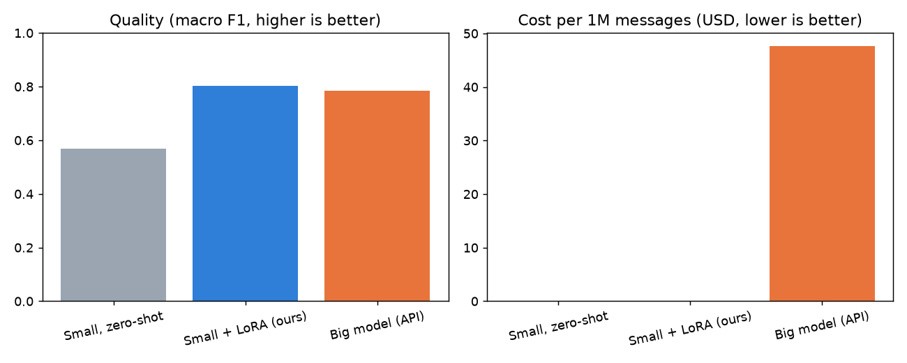

# Small Beats Big - a 0.5B model fine-tuned on a laptop beats OpenAI's 120B model

**Task:** moderate gaming chat, flagging each message as *offensive* or *clean*.
**Small model:** Qwen2.5-0.5B-Instruct, fine-tuned with **LoRA** on a 4 GB laptop GPU (RTX 3050).
**Big model:** OpenAI GPT-OSS-120B via the Groq API. It is **240x bigger**.

## Results (same 860 human-labelled test messages, same prompt)

| Contender | Macro F1 | Accuracy | Speed | Cost / 1M messages |
|---|---|---|---|---|
| Qwen 0.5B, no training (zero-shot) | 0.568 | 57.0% | 34 ms | ~$0.08 (electricity) |
| **Qwen 0.5B + LoRA (ours)** | **0.802** | **85.7%** | **42 ms** | **~$0.10 (electricity)** |
| OpenAI GPT-OSS-120B (API) | 0.784 | 83.3% | 473 ms | $47.70 (API tokens) |



**The fine-tuned 0.5B model beats the 120B model (+0.018 F1). It is ~11x faster, ~477x cheaper, and runs offline on a laptop.**

- LoRA training: 1 epoch on 11,916 messages in **33 min on an RTX 3050 4 GB laptop GPU**.
- Trainable parameters: 8.8M of 503M (**1.75%**). The adapter file is 45 MB.
- For reference, the best team in the original OffensEval 2019 competition scored 0.829 macro F1 using a fully fine-tuned BERT.
- Lesson learned: running an evaluation pass in the middle of training filled the 4 GB of GPU memory, spilled into system RAM and made training 13x slower. The mid-training evaluation is now turned off.

## Pipeline
1. **Dataset** - OffensEval / `tweet_eval:offensive`: 11,916 train, 1,324 validation and 860 test messages, all labelled by humans. They are short, informal and insulting text, much like game chat.
2. **Prompt format** - the same instruction is given to every contender (`src/common.py`).
3. **LoRA fine-tune** (`src/train_lora.py`) - the 500M base weights are frozen and small adapters (~1% of the parameters) are trained on q/k/v/o and MLP layers. Settings: rank 16, bf16, gradient checkpointing, and loss computed only on the answer token.
4. **Evaluation** (`src/evaluate.py`) - every contender gets the same 860 test messages. It reports macro F1, accuracy, latency, and cost per 1M messages (API tokens for the big model, laptop electricity for the small one).
5. **Scoreboard** (`src/compare.py`) - writes `reports/RESULTS.md` and `reports/scoreboard.png`.
6. **Deployment** (`app.py`) - a Gradio web demo that runs 100% locally.

## Live demo (React + FastAPI)
Double-click **`start.bat`**, or run `python api.py`, then open http://127.0.0.1:8002

- `api.py` is the FastAPI server: a JSON API at `/api/...` that also serves the React page.
- `web/` holds the React app (Vite). After changing it, run `cd web && npm install && npm run build`.

## Run it
```powershell
cd "Desktop\AI Projects\2-small-beats-big"
.venv\Scripts\activate
# first time only:
pip install torch --index-url https://download.pytorch.org/whl/cu128
pip install -r requirements.txt

python src/evaluate.py --model base      # before training (zero-shot)
python src/train_lora.py                 # ~30-40 min on RTX 3050
python src/evaluate.py --model lora      # after training

# big model baseline: put BIG_API_KEY=gsk_... in a .env file (free key: https://console.groq.com/keys)
python src/evaluate.py --model api       # ~30 min (free tier rate limit)

python src/compare.py                    # final table + chart
python app.py                            # demo at http://127.0.0.1:7860
```

## What this project shows (for a CV)
- Parameter-efficient fine-tuning (LoRA / PEFT) on consumer hardware
- Building an instruction dataset with proper train/val/test splits
- Fair evaluation (same prompt, same test set, macro F1) and cost/latency analysis
- Local deployment of a fine-tuned model with no API dependency
